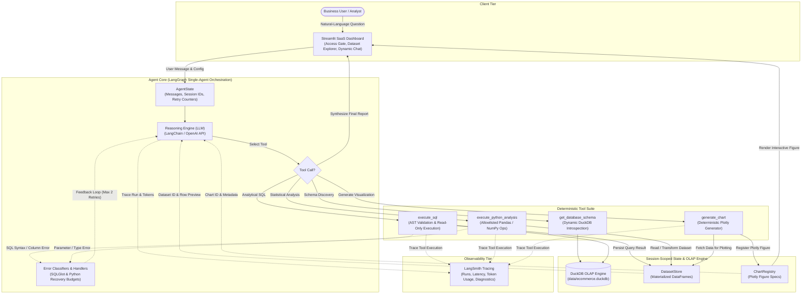

# Data Analytics & Business Intelligence Agent

**Live Demo:** [https://agentic-data-analytic-and-business-intelligence.streamlit.app/](https://agentic-data-analytic-and-business-intelligence.streamlit.app/)  
**GitHub Repository:** [https://github.com/y336shen719/Agentic-Data-Analytic-and-Business-Intelligence](https://github.com/y336shen719/Agentic-Data-Analytic-and-Business-Intelligence)

> **Note on Demo Access:** The live deployment is password-protected to ensure controlled demonstration access and manage API resource consumption. Access credentials are provided directly to evaluators and technical recruiters upon request.

---

## Project Overview

The **Data Analytics & Business Intelligence Agent** is an autonomous, stateful AI analytics system designed to translate natural-language business inquiries into executable database queries, rigorous statistical analyses, and interactive visualizations. Built upon the [Olist Brazilian E-Commerce Public Dataset](https://www.kaggle.com/datasets/olistbr/brazilian-ecommerce) (~100,000 real-world commercial orders), the system empowers stakeholders to explore complex commercial data without writing SQL or Python.

Unlike conventional generative chatbots that fabricate answers or generate unvalidated code, this system implements a **stateful single-agent architecture** orchestrated by **LangGraph**. The agent inspects database schemas dynamically, formulates and executes read-only analytical SQL queries in **DuckDB**, executes bounded statistical computations via **Pandas/NumPy**, and registers interactive **Plotly** figures in session memory. Multi-turn conversational state and intermediate query results are maintained across turns, enabling iterative drill-downs without redundant database overhead.

---

## Key Features & Engineering Value

| Feature | Engineering Implementation | Engineering Value |
|---|---|---|
| **Natural-Language Analytics** | Domain-prompted LLM reasoning mapped to structured tool execution | Translates ambiguous business inquiries into precise analytical workflows without requiring technical SQL/Python knowledge. |
| **Stateful LangGraph Orchestration** | Compiled `StateGraph` managing conversational turns, memory, tool routing, and termination | Eliminates brittle hardcoded workflows; supports autonomous multi-step reasoning while bounding graph execution cycles. |
| **Dynamic SQL Generation & Execution** | Read-only **DuckDB** connection with AST validation via **SQLGlot** | Pre-execution AST verification prevents SQL injection, restricts queries to `SELECT`/CTEs, and enforces row scan limits. |
| **Sandboxed Statistical Analysis** | Bounded Python analytical operations (`describe`, `correlation`, `growth_rate`, `detect_outliers`, `groupby`) | Delivers advanced statistical capabilities while strictly prohibiting unrestricted arbitrary code execution. |
| **Interactive Plotly Visualizations** | Session-scoped `ChartRegistry` supporting 6 chart types (`bar`, `line`, `scatter`, `histogram`, `box`, `heatmap`) | Generates client-side interactive charts while passing compact references (`chart_id`) to the LLM to prevent context bloat. |
| **Multi-Turn Dataset Reuse** | In-memory `DatasetStore` persisting intermediate query results across conversational turns | Enables immediate follow-up analyses and visualizations directly on prior results with zero redundant database queries. |
| **Execution Transparency & Auditability** | Expandable UI diagnostic cards exposing SQL syntax, row counts, runtime latency, and Python results | Provides full observability into the agent's internal reasoning and data transformations for technical verification. |
| **Bounded Error Recovery** | Deterministic SQL and Python error classifiers with isolated retry budgets (max 2 retries) | Automatically recovers from schema errors and invalid parameters without risking infinite self-correction loops. |
| **End-to-End LangSmith Tracing** | Native LangSmith integration with explicit per-turn trace flushing and credential redaction | Delivers enterprise-grade observability into node transitions, latency, token consumption, and tool payloads. |
| **Rigorous Evaluation Framework** | 20-scenario business benchmark + 20 deterministic fault-injection tests with exact numerical tolerance checking | Verifies analytical accuracy and system resilience against independent ground truths before deployment. |
| **Production-Ready SaaS Interface** | Streamlit web application styled with scoped CSS design tokens and authentication | Combines an enterprise dashboard aesthetic with secure access control and responsive visualization rendering. |

---

## System Architecture

The application is implemented as a **stateful single-agent system** with deterministic tool integration, bounded error recovery, and external observability.



---

## Technology Stack

| Layer | Component / Library | Purpose in System |
|---|---|---|
| **Core Runtime** | Python 3.11 | Primary language runtime across backend, tools, and UI |
| **Agent Orchestration** | LangGraph (`>=0.2.0`) / LangChain Core | Manages single-agent state graph, cyclic routing, and conversation memory |
| **Language Model** | OpenAI API (`gpt-4o` / `gpt-4o-mini` / `gpt-6-luna`) | Multi-step reasoning, query formulation, and analytical synthesis |
| **OLAP Database** | DuckDB (`>=1.0.0`) | High-performance, in-process columnar database for analytical SQL queries |
| **Query Validation** | SQLGlot | AST parsing, DDL/DML mutation blocking, and structural validation |
| **Data Processing** | Pandas, NumPy | In-memory dataset transformations, descriptive statistics, and IQR calculation |
| **Visualizations** | Plotly (`plotly.graph_objects`, `plotly.express`) | Interactive client-side charting (bar, line, scatter, histogram, box, heatmap) |
| **Observability** | LangSmith (`langsmith`) | Full execution tree tracing, per-turn trace flushing, and prompt evaluation |
| **Frontend UI** | Streamlit + Custom Scoped CSS | Enterprise SaaS interface with responsive layout and security gates |
| **Automated Testing** | Pytest | 768 unit, integration, reliability, and regression test cases |
| **Production Hosting** | Streamlit Community Cloud | Cloud deployment with Git LFS database storage and secure secrets management |

---

## Dataset & Data Modeling

The system queries the **Olist Brazilian E-Commerce Public Dataset**, covering **99,441 orders** placed between **2016 and 2018** across Brazil. The relational model comprises 9 base tables and 2 pre-aggregated analytical views designed specifically for OLAP efficiency:

### Base Relational Tables

| Table | Rows | Primary Key | Key Attributes & Description |
|---|---:|---|---|
| `orders` | 99,441 | `order_id` | Core order lifecycle: timestamps for purchase, approval, shipping, delivery, and estimated delivery. |
| `customers` | 99,441 | `customer_id` | Customer profile: `customer_unique_id` (individual identity), city, state, and zip code prefix. |
| `order_items` | 112,650 | `(order_id, order_item_id)` | Line items: product reference, seller ID, unit selling price, and freight fees. |
| `order_payments` | 103,886 | `(order_id, payment_sequential)` | Payment transactions: payment method, installment count, and transaction amount. |
| `order_reviews` | 99,224 | `(review_id, order_id)` | Customer feedback: satisfaction score (1 to 5), survey dispatch, and submission timestamps. |
| `products` | 32,951 | `product_id` | Product catalog: category classification, name/description length, photos, and physical dimensions. |
| `sellers` | 3,095 | `seller_id` | Merchant directory: seller city, state, and geographic zip code prefix. |
| `category_translation` | 71 | `product_category_name` | Direct mapping between Portuguese category names and English translations. |
| `geolocation` | 1,000,163 | Composite / Non-unique | Coordinate lookup: zip code prefix, latitude, longitude, city, and state mapping. |

### Analytical Pre-Aggregated Views

To ensure high-performance querying and eliminate common SQL join traps, the database schema provides two specialized analytical views:

1. **`order_summary` (99,441 rows — 1 row per order):**
   - **Architectural Purpose:** Eliminates the **join fanout trap**. Directly joining `order_items` (112k rows) and `order_payments` (103k rows) multiplies rows for multi-item, multi-payment orders, severely inflating sums. `order_summary` pre-aggregates item counts, subtotal merchandise value, freight totals, gross order values, payment amounts, review ratings, and delivery cycle duration at the order grain.
2. **`category_sales_summary` (1,283 rows — 1 row per month × category):**
   - **Architectural Purpose:** Pre-computes monthly category metrics including total orders, units sold, gross sales, freight totals, delivered revenue, and active sellers. Enables near-instantaneous time-series and category ranking queries.

> **Read-Only Guarantee:** The DuckDB connection is established using `read_only=True`. In addition, every SQL query is parsed using SQLGlot AST analysis before execution. Any mutation statements (`INSERT`, `UPDATE`, `DELETE`, `DROP`, `ALTER`, `ATTACH`) or file-reading functions (`read_csv`, `read_parquet`) are rejected before reaching the database engine.

---

## Example Business Questions

The agent handles diverse analytical scenarios, from standard reporting to multi-step statistical evaluations:

- **Revenue Ranking by Category:**  
  *"What are the top 5 product categories by delivered revenue, and what percentage of total revenue do they represent?"*
- **Time-Series Revenue Trends:**  
  *"Show the monthly revenue trend throughout 2017 as a line chart with data points."*
- **Delivery Cycle Performance:**  
  *"What is the average delivery duration in days for each customer state, and which 5 states experience the longest shipping times?"*
- **Review Score Distributions:**  
  *"Show the distribution of customer review scores across all delivered orders as a bar chart."*
- **Price vs. Freight Correlation:**  
  *"Calculate the Pearson correlation between item price and freight value. Are higher-priced items significantly more expensive to ship?"*
- **Regional Fulfillment Analysis:**  
  *"Compare the total sales, average delivery duration, and average customer satisfaction between São Paulo (SP) and Rio de Janeiro (RJ)."*
- **Multi-Turn Follow-Up Analysis:**  
  - *Turn 1:* *"Find the top 5 product categories by revenue."*  
  - *Turn 2:* *"Generate a horizontal bar chart visualizing these categories."* *(Directly consumes prior dataset with zero redundant SQL calls)*  
  - *Turn 3:* *"Which of these top categories has the highest average item price?"*

---

## Evaluation & Observability

### Comprehensive Evaluation Framework

The project includes an independent, automated evaluation framework (`evaluation/`) that assesses agent behavior across both realistic business queries and adversarial failure scenarios:

1. **Analytical Benchmark Suite (20 Scenarios):**  
   Evaluates 20 diverse tasks across 6 distinct categories: `basic_sql`, `business_analytics`, `statistical_analysis`, `visualization`, `multi_turn`, and `reliability_safety`.
2. **Reliability & Fault-Injection Suite (20 Scenarios):**  
   Deterministically tests system resilience against injected syntax errors, missing columns, worker timeouts, unsupported chart configurations, session contamination, and malicious AST injection attempts (`DROP TABLE`).
3. **Automated Unit & Integration Suite:**  
   768 deterministic tests executed via `pytest`, ensuring comprehensive regression coverage across tools, state transitions, prompt formatting, and UI handlers.

### Verified Benchmark Results

The following metrics reflect the official evaluation benchmark run against the live model and DuckDB database (`evaluation/results/`):

| Evaluation Metric | Benchmark Result | Tested Sample Size | Description & Verification Standard |
|---|---:|:---:|---|
| **Task Success Rate** | **95.0%** | 19 / 20 | Complete resolution of user analytical objective without runtime exceptions |
| **Strict Pass Rate** | **80.0%** | 16 / 20 | Stringent criteria requiring perfect numerical accuracy, tool sequence, and chart registration |
| **Analytical Accuracy** | **100.0%** | 14 / 14 | Evaluated against independent DuckDB ground truths within explicit numerical tolerances |
| **Tool Selection Quality** | **97.2%** | — | Measures efficiency of selected tool path and absence of redundant operations |
| **Visualization Success** | **83.3%** | 5 / 6 | Validates valid Plotly figure registration, data trace alignment, and chart semantics |
| **Multi-Turn Success** | **100.0%** | 2 / 2 | Verifies context preservation and dataset reuse with **0 redundant SQL queries** |
| **Reliability & Safety** | **100.0%** | 2 / 2 | Deterministic refusal / AST blocking of destructive commands without data corruption |
| **Pytest Test Suite** | **100.0%** | 768 / 768 | Deterministic unit, integration, and reliability regression test pass rate |

### LangSmith Tracing & Observability

Observability is integrated natively via the LangSmith SDK:
- **Execution Tree Tracing:** Traces every step of the LangGraph execution, including `llm_node` invocations, tool arguments, latency, token usage, and graph edge transitions.
- **Data Protection & Key Redaction:** Automatically scrubs API keys, authorization tokens, and credentials from metadata prior to transmission.
- **Context-Preserving Payloads:** Full DuckDB query results and large Plotly figure JSON structures are retained in local application memory; only compact previews (up to 5 rows) and metadata IDs are uploaded.
- **Explicit Per-Turn Flushing:** Traces are synchronously flushed to LangSmith at the conclusion of each turn to prevent dropped spans in ephemeral container runtimes.

---

## Installation & Local Setup

### Prerequisites

- **Python 3.11**
- **Git** & **Git LFS** (required to pull the DuckDB database)
- **OpenAI API Key** with access to `gpt-4o`, `gpt-4o-mini`, or equivalent models.  
  *(Note: A ChatGPT Plus/Team/Pro web subscription cannot be used in place of an OpenAI API key).*

### Step-by-Step Setup

1. **Clone the repository:**
   ```bash
   git clone https://github.com/y336shen719/Agentic-Data-Analytic-and-Business-Intelligence.git
   cd Agentic-Data-Analytic-and-Business-Intelligence
   ```

2. **Verify Git LFS and database availability:**
   ```bash
   git lfs pull
   ```
   *If building the database from raw CSV sources instead, execute:*
   ```bash
   python -m data.prepare_data
   ```

3. **Create and activate a virtual environment:**
   ```bash
   # Using venv
   python3.11 -m venv .venv
   source .venv/bin/activate

   # Or using Conda
   conda create -n agentic-bi python=3.11 -y
   conda activate agentic-bi
   ```

4. **Install required dependencies:**
   ```bash
   pip install -r requirements.txt
   ```

5. **Configure environment variables:**
   ```bash
   cp .env.example .env
   ```
   Open `.env` and configure your credentials:
   ```dotenv
   # Required: OpenAI Credentials
   OPENAI_API_KEY=your_actual_openai_api_key_here
   OPENAI_MODEL=gpt-4o
   OPENAI_TIMEOUT_SECONDS=30
   OPENAI_MAX_RETRIES=2

   # Optional: Local Streamlit Password Protection
   APP_ACCESS_PASSWORD=your_local_access_password

   # Optional: LangSmith Tracing & Observability
   LANGSMITH_TRACING=false
   LANGSMITH_API_KEY=your_langsmith_api_key_here
   LANGSMITH_PROJECT=agentic-data-analyst
   LANGSMITH_DATASET=agentic-data-analyst-benchmark-v1
   ```

6. **Run the automated test suite:**
   ```bash
   python -m pytest tests/ -q
   ```

7. **Launch the Streamlit application:**
   ```bash
   streamlit run app.py
   ```
   The application will open in your default browser at `http://localhost:8501`.

---

## Deployment

The application is deployed on **Streamlit Community Cloud**:  
**Live URL:** [https://agentic-data-analytic-and-business-intelligence.streamlit.app/](https://agentic-data-analytic-and-business-intelligence.streamlit.app/)

### Production Deployment Architecture
- **Hosting Platform:** Streamlit Community Cloud linked directly to the GitHub repository.
- **Database Handling via Git LFS:** The pre-indexed DuckDB database (`data/ecommerce.duckdb`) is tracked via Git Large File Storage (`.gitattributes`), ensuring immediate availability in the cloud runtime without recurring data ingestion overhead.
- **Server-Side Secret Management:** Sensitive variables (`OPENAI_API_KEY`, `APP_ACCESS_PASSWORD`, `LANGSMITH_API_KEY`) are managed securely via Streamlit Cloud Secrets and never exposed in client bundles.
- **Continuous Deployment:** Cloud instances automatically rebuild and redeploy upon verified commits pushed to the `main` branch.
- **Password Access Control:** Access to the web interface is restricted by a password gate using `hmac.compare_digest` to prevent unauthorized query execution while maintaining a controlled portfolio demo.

---

## Repository Structure

```text
.
├── app.py                      # Main Streamlit web application & UI layout
├── requirements.txt            # Declared Python library dependencies
├── pytest.ini                  # Pytest runner configuration & test markers
├── .env.example                # Template for local environment variables
├── .gitattributes              # Git LFS configuration for DuckDB database file
├── AGENTS.md                   # Engineering principles & constraints
├── LICENSE                     # MIT License
├── README.md                   # Project documentation
│
├── agent/                      # Stateful Agent Core
│   ├── graph.py                # LangGraph StateGraph compiled execution loop
│   ├── state.py                # TypedDict AgentState definition
│   ├── prompts.py              # System prompts & schema instruction templates
│   ├── llm.py                  # OpenAI model initialization & client setup
│   ├── tool_wrappers.py        # LangChain tool interfaces & parameter schemas
│   ├── ui_session.py           # Streamlit session lifecycle & state binding
│   ├── tracing.py              # LangSmith telemetry, redaction & trace flushing
│   ├── sql_error_classifier.py # AST/runtime SQL error categorization
│   └── python_error_classifier.py # Python runtime error categorization
│
├── tools/                      # Deterministic Tool Implementations
│   ├── sql_tool.py             # DuckDB read-only query execution & AST security checks
│   ├── python_analysis.py      # Bounded Pandas/NumPy statistical analysis engine
│   ├── chart_generation.py     # Deterministic Plotly figure generator
│   ├── dataset_store.py        # In-memory session store for intermediate DataFrames
│   └── chart_registry.py       # Session-scoped registry for Plotly figure specs
│
├── data/                       # Database & Data Ingestion
│   ├── ecommerce.duckdb        # DuckDB embedded database file (Git LFS)
│   ├── schema.md               # Authoritative schema reference & column definitions
│   └── prepare_data.py         # Ingestion script to build DuckDB from raw CSVs
│
├── evaluation/                 # Evaluation Framework & Benchmark
│   ├── evaluate.py             # Benchmark runner (offline deterministic & live API modes)
│   ├── benchmark.py            # 20 analytical benchmark scenario definitions
│   ├── ground_truth.py         # Independent DuckDB ground truth calculations
│   ├── metrics.py              # Strict numerical tolerance & semantic scoring engine
│   ├── reliability.py          # 20 deterministic fault-injection scenarios
│   ├── langsmith_integration.py# LangSmith Dataset & Experiment synchronization
│   ├── test_cases.json         # Serialized scenario definitions & reference values
│   └── results/                # Evaluation run reports (JSON & CSV exports)
│
├── tests/                      # Automated Test Suite (768 Tests)
│   ├── test_sql_tool.py        # Unit tests for DuckDB execution & AST validation
│   ├── test_python_analysis.py # Unit tests for allowlisted statistical operations
│   ├── test_chart_generation.py# Unit tests for Plotly figure construction
│   ├── test_agent_graph.py     # StateGraph cycle & transition tests
│   ├── test_reliability.py     # Fault-injection & recovery verification tests
│   ├── test_ui_session.py      # Multi-turn session isolation tests
│   └── test_app_redesign.py    # Streamlit component & layout regression tests
│
├── assets/                     # Frontend Assets & Custom Styling
│   ├── styles.css              # Modern SaaS CSS design system & component tokens
│   ├── favicon.svg             # Minimalist vector favicon
│   └── favicon.png             # Raster favicon asset
│
└── docs/                       # Technical Specifications & Documentation
    ├── architecture.md         # System architecture & component responsibilities
    ├── chart_generation_engine.md # Detailed specification of Plotly engine
    ├── python_analysis_engine.md  # Detailed specification of statistical engine
    └── sql_error_classification.md# SQL error taxonomy & recovery mechanics
```

---

## User Interface

The user interface is designed as an **enterprise SaaS analytics dashboard** combining native Streamlit widgets with carefully scoped custom CSS:

- **Sidebar Control Center:** Provides clear branding, session health metrics (message counts, registered datasets, generated charts), administrator diagnostic tools, and quick conversation reset.
- **Interactive Dataset Explorer:** An expandable schema catalog displaying table grains, column data types, financial definitions, and entity-relationship notes.
- **Dedicated Input Form:** Positioned directly beneath the dataset explorer with instant example prompts for rapid testing.
- **Scrollable Conversation Stream:** Encapsulated in an independently scrollable chat container featuring markdown analytical responses, expandable SQL/Python tool execution cards, and interactive Plotly figures with zoom, hover, and export features.

> *Live interface demonstration available at [https://agentic-data-analytic-and-business-intelligence.streamlit.app/](https://agentic-data-analytic-and-business-intelligence.streamlit.app/).*

---

## License

This project is open-source and distributed under the terms of the **MIT License**. See [LICENSE](LICENSE) for details.
