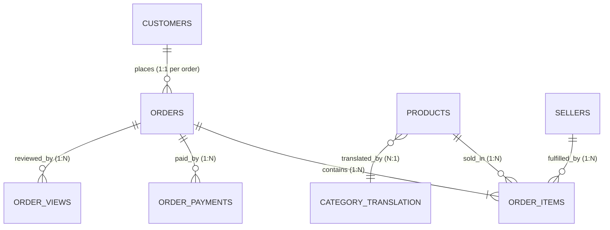

# Olist Brazilian E-Commerce DuckDB Schema Documentation

This document serves as the authoritative database reference and context for human engineers and automated LLM SQL Agents querying the Olist E-Commerce dataset in DuckDB (`data/ecommerce.duckdb`).

---

## 1. Overview & Architecture

- **Database Engine**: DuckDB
- **Database File**: `data/ecommerce.duckdb`
- **Total Base Tables**: 9
- **Total Analysis-Ready Views**: 2
- **Data Ingestion Script**: `data/prepare_data.py`
- **Source**: Brazilian E-Commerce Public Dataset by Olist (100k orders from 2016 to 2018).

All identifiers (UUID hashes, postal zip code prefixes) are stored as `VARCHAR` to preserve leading zeros. All datetime columns are stored as SQL `TIMESTAMP`. All financial monetary amounts (`price`, `freight_value`, `payment_value`) use fixed-point `DECIMAL(18,2)` to guarantee exact financial arithmetic without floating-point precision loss.

---

## 2. Base Table Specifications

### 2.1 `customers`
- **Purpose**: Customer account records and shipping location details.
- **Granularity**: 1 row per order-specific customer account (`customer_id`).
- **Logically Validated Primary Key**: `customer_id` (Unique, 99,441 rows, 0 nulls).
- **Foreign Keys**: None (referenced by `orders.customer_id`).
- **Entity Identity Note**: `customer_unique_id` represents the unique individual consumer (96,096 distinct individuals). A customer who places multiple orders receives a new `customer_id` for each order, both referencing the same `customer_unique_id`.

| Column | Type | Nullable | Description | Example |
|---|---|---|---|---|
| `customer_id` | VARCHAR | NO | Order-specific customer key (Primary Key) | `06b8999e2fba1a1fbc88172c00ba8bc7` |
| `customer_unique_id` | VARCHAR | NO | Unique identity of the customer across orders | `861eff4711a542e4b93843c6dd7febb0` |
| `customer_zip_code_prefix`| VARCHAR | NO | 5-digit Brazilian postal code prefix (preserves leading zeros) | `01440` |
| `customer_city` | VARCHAR | NO | City name | `franca` |
| `customer_state` | VARCHAR | NO | Two-letter Brazilian state abbreviation (UF) | `SP` |

---

### 2.2 `orders`
- **Purpose**: Core order transaction table tracking fulfillment lifecycle timestamps and order statuses.
- **Granularity**: 1 row per order (`order_id`).
- **Logically Validated Primary Key**: `order_id` (Unique, 99,441 rows, 0 nulls).
- **Foreign Keys**: `customer_id` -> `customers.customer_id` (1:1 relationship, 0 orphans).

| Column | Type | Nullable | Description | Example |
|---|---|---|---|---|
| `order_id` | VARCHAR | NO | Unique order identifier (Primary Key) | `e481f51cbdc54678b7cc49136f2d6af7` |
| `customer_id` | VARCHAR | NO | Foreign key to `customers` | `9ef432eb6251297304e76186b10a928d` |
| `order_status` | VARCHAR | NO | Lifecycle status: `delivered`, `shipped`, `canceled`, `unavailable`, `invoiced`, `processing`, `created`, `approved` | `delivered` |
| `order_purchase_timestamp` | TIMESTAMP | NO | Timestamp when purchase was placed | `2017-10-02 10:56:33` |
| `order_approved_at` | TIMESTAMP | YES | Payment approval timestamp (160 nulls) | `2017-10-02 11:07:15` |
| `order_delivered_carrier_date` | TIMESTAMP | YES | Hand-off timestamp to logistics carrier (1,783 nulls) | `2017-10-04 19:55:00` |
| `order_delivered_customer_date` | TIMESTAMP | YES | Actual delivery timestamp to customer (2,965 nulls) | `2017-10-10 21:25:13` |
| `order_estimated_delivery_date` | TIMESTAMP | NO | Estimated delivery date communicated at purchase | `2017-10-18 00:00:00` |

---

### 2.3 `order_items`
- **Purpose**: Line items purchased within each order, specifying product, seller, price, and freight fees.
- **Granularity**: 1 row per item within an order (`order_id`, `order_item_id`).
- **Logically Validated Primary Key**: Composite `(order_id, order_item_id)` (Unique, 112,650 rows, 0 nulls).
- **Foreign Keys**:
  - `order_id` -> `orders.order_id` (0 orphans)
  - `product_id` -> `products.product_id` (0 orphans)
  - `seller_id` -> `sellers.seller_id` (0 orphans)

| Column | Type | Nullable | Description | Example |
|---|---|---|---|---|
| `order_id` | VARCHAR | NO | Order identifier | `00010242fe8c5a6d1ba2dd792cb16214` |
| `order_item_id` | INTEGER | NO | Item sequence number within the order (1, 2, 3...) | `1` |
| `product_id` | VARCHAR | NO | Catalog product identifier | `4244733e06e7ecb49c54057777174712` |
| `seller_id` | VARCHAR | NO | Merchant identifier | `48436dade18ac8b2bce089ec2a041202` |
| `shipping_limit_date` | TIMESTAMP | NO | Seller fulfillment deadline to carrier | `2017-09-19 09:45:35` |
| `price` | DECIMAL(18,2) | NO | Item unit selling price in BRL | `58.90` |
| `freight_value` | DECIMAL(18,2) | NO | Item shipping / freight fee in BRL | `13.29` |

---

### 2.4 `order_payments`
- **Purpose**: Payment transactions, split methods, installment counts, and transaction amounts.
- **Granularity**: 1 row per payment sequence for an order (`order_id`, `payment_sequential`).
- **Logically Validated Primary Key**: Composite `(order_id, payment_sequential)` (Unique, 103,886 rows, 0 nulls).
- **Foreign Keys**: `order_id` -> `orders.order_id` (0 orphans).

| Column | Type | Nullable | Description | Example |
|---|---|---|---|---|
| `order_id` | VARCHAR | NO | Order identifier | `b81ef226f3fe1789b1e8b2acac839d17` |
| `payment_sequential` | INTEGER | NO | Payment sequence number (1, 2...) for multi-payment orders | `1` |
| `payment_type` | VARCHAR | NO | Method: `credit_card`, `boleto`, `voucher`, `debit_card`, `not_defined` | `credit_card` |
| `payment_installments` | INTEGER | NO | Selected installment count | `8` |
| `payment_value` | DECIMAL(18,2) | NO | Paid amount in BRL | `99.33` |

---

### 2.5 `order_reviews`
- **Purpose**: Customer survey feedback, ratings, and freeform text comments.
- **Granularity**: 1 row per review per order (`review_id`, `order_id`).
- **Logically Validated Primary Key**: Composite `(review_id, order_id)` (Unique, 99,224 rows, 0 nulls).
- **Foreign Keys**: `order_id` -> `orders.order_id` (0 orphans).
- **Note**: `review_id` alone is not globally unique across orders because customers purchasing across orders can share survey responses, or duplicate surveys can be assigned to linked orders.

| Column | Type | Nullable | Description | Example |
|---|---|---|---|---|
| `review_id` | VARCHAR | NO | Review survey identifier | `7bc64bcad65e086f9f470a4884eb5668` |
| `order_id` | VARCHAR | NO | Order identifier | `73fc7af87114b39712e6da79b0a377eb` |
| `review_score` | INTEGER | NO | Rating from 1 (lowest) to 5 (highest) | `4` |
| `review_comment_title` | VARCHAR | YES | Review title (87,656 nulls) | `Recomendo` |
| `review_comment_message`| VARCHAR | YES | Review commentary (58,247 nulls) | `muito bom produto` |
| `review_creation_date` | TIMESTAMP | NO | Date satisfaction survey was dispatched | `2018-01-18 00:00:00` |
| `review_answer_timestamp`| TIMESTAMP| NO | Timestamp customer submitted response | `2018-01-18 21:46:59` |

---

### 2.6 `products`
- **Purpose**: Master product catalog including physical packaging dimensions and category classification.
- **Granularity**: 1 row per product (`product_id`).
- **Logically Validated Primary Key**: `product_id` (Unique, 32,951 rows, 0 nulls).

| Column | Type | Nullable | Description | Example |
|---|---|---|---|---|
| `product_id` | VARCHAR | NO | Catalog product identifier (Primary Key) | `1e9e8ef04dbcff4541ed26657ea517e5` |
| `product_category_name` | VARCHAR | YES | Category name in Portuguese (610 nulls) | `perfumaria` |
| `product_name_lenght` | INTEGER | YES | Character length of product name (610 nulls) | `40` |
| `product_description_lenght` | INTEGER | YES | Character length of product description (610 nulls) | `287` |
| `product_photos_qty` | INTEGER | YES | Number of photos in product listing (610 nulls) | `1` |
| `product_weight_g` | INTEGER | YES | Weight in grams (2 nulls) | `225` |
| `product_length_cm` | INTEGER | YES | Package length in centimeters (2 nulls) | `16` |
| `product_height_cm` | INTEGER | YES | Package height in centimeters (2 nulls) | `10` |
| `product_width_cm` | INTEGER | YES | Package width in centimeters (2 nulls) | `14` |

---

### 2.7 `sellers`
- **Purpose**: Registered marketplace merchants fulfilling orders.
- **Granularity**: 1 row per seller (`seller_id`).
- **Logically Validated Primary Key**: `seller_id` (Unique, 3,095 rows, 0 nulls).

| Column | Type | Nullable | Description | Example |
|---|---|---|---|---|
| `seller_id` | VARCHAR | NO | Unique merchant identifier (Primary Key) | `3442f8959a84dea7ee197c632cb2df15` |
| `seller_zip_code_prefix`| VARCHAR | NO | 5-digit Brazilian postal code prefix | `13023` |
| `seller_city` | VARCHAR | NO | City name | `campinas` |
| `seller_state` | VARCHAR | NO | Two-letter Brazilian state abbreviation (UF) | `SP` |

---

### 2.8 `category_translation`
- **Purpose**: Translates Portuguese product categories into English.
- **Granularity**: 1 row per category (`product_category_name`).
- **Logically Validated Primary Key**: `product_category_name` (Unique, 71 rows, 0 nulls).

| Column | Type | Nullable | Description | Example |
|---|---|---|---|---|
| `product_category_name` | VARCHAR | NO | Category in Portuguese (Primary Key) | `beleza_saude` |
| `product_category_name_english` | VARCHAR | NO | English translated name | `health_beauty` |

---

### 2.9 `geolocation`
- **Purpose**: Geographic coordinates and state/city mapping for Brazilian zip code prefixes.
- **Granularity**: Multi-record geographic reference table (1,000,163 rows).
- **Logically Validated Primary Key**: None. Contains multiple coordinate points and 261,831 exact duplicate rows.

| Column | Type | Nullable | Description | Example |
|---|---|---|---|---|
| `geolocation_zip_code_prefix` | VARCHAR | NO | 5-digit postal code prefix | `01037` |
| `geolocation_lat` | DOUBLE | NO | Latitude coordinate | `-23.545621` |
| `geolocation_lng` | DOUBLE | NO | Longitude coordinate | `-46.639292` |
| `geolocation_city` | VARCHAR | NO | City name | `sao paulo` |
| `geolocation_state` | VARCHAR | NO | Brazilian state abbreviation (UF) | `SP` |

---

## 3. Logical Validation vs. Physical Constraints in DuckDB

In this architecture, keys and relationships are **logically validated** inside an atomic transaction during pipeline execution rather than declared as physical database schema constraints (`PRIMARY KEY`, `FOREIGN KEY`):

1. **OLAP Query Engine Characteristics**: DuckDB is a vectorized analytical database. Declaring physical foreign keys or primary key indexes adds write amplification and maintenance overhead on batch analytical loads without enhancing vectorized read scan throughput.
2. **Ingestion Atomicity & Invariant Guarantees**: Rather than relying on physical constraints (which in DuckDB do not enforce multi-table foreign keys upon `CREATE OR REPLACE TABLE AS SELECT`), the data pipeline executes explicit SQL `GROUP BY` uniqueness, non-nullness, and orphan-check queries. If any candidate key fails uniqueness or contains NULLs, or if any foreign key is orphaned, `CriticalValidationError` is raised and the transaction is rolled back.
3. **Preservation of Raw Truth**: Physical constraints reject or truncate rows on insertion. Logical validation guarantees that the committed database satisfies 100% of the integrity invariants without mutating raw dataset semantics.

---

## 4. Entity-Relationship & Canonical JOIN Paths



### Canonical JOIN Patterns

1. **Order to Customer**:
   ```sql
   FROM orders o
   JOIN customers c ON o.customer_id = c.customer_id
   ```

2. **Order to Items to Product Catalog**:
   ```sql
   FROM orders o
   JOIN order_items oi ON o.order_id = oi.order_id
   JOIN products p ON oi.product_id = p.product_id
   LEFT JOIN category_translation ct ON p.product_category_name = ct.product_category_name
   JOIN sellers s ON oi.seller_id = s.seller_id
   ```

3. **Avoid the Join Fanout Trap**:
   > [!CAUTION]
   > **DO NOT** join `order_items` and `order_payments` directly together in a single `SELECT` query!
   > An order with 3 items and 2 payments will produce `3 × 2 = 6` rows. Calculating `SUM(oi.price)` on this joined table will inflate total revenue by 2x, and `SUM(op.payment_value)` will inflate total payments by 3x.
   > **Rule**: Always pre-aggregate `order_items` and `order_payments` in CTEs before joining to `orders`, or query the pre-aggregated `order_summary` view.

---

## 5. Missing Data & Data Quality Realities

1. **Order Fulfillment Timestamps**:
   - `order_delivered_customer_date`: 2,965 NULLs. These orders were either canceled (625), unavailable (609), shipped but not yet delivered (1,107), or in earlier processing states.
   - `order_approved_at`: 160 NULLs.
   - `order_delivered_carrier_date`: 1,783 NULLs.
2. **Orders Without Items (775 Orders)**:
   - Exactly 775 orders in `orders` have no records in `order_items`. These are primarily `unavailable` (603), `canceled` (164), `created` (5), `invoiced` (2), or `shipped` (1).
   - In `order_summary`, their `item_count` is `0` and `item_subtotal` is default `0.00`.
   - **Modeling Meaning**: A zero-filled item subtotal for an order with no item records represents a **modeling default**, not proof of a real free/zero-value transaction.
3. **Orders Without Payments (1 Order)**:
   - Exactly 1 order (`bfbd0f9bdef84302105ad712db648a6c`) has no payment record in `order_payments`.
4. **Missing Category Translations**:
   - 610 products have a `NULL` category name.
   - Two categories in `products` have no English translation in `category_translation`:
     - `portateis_cozinha_e_preparadores_de_alimentos` (portable kitchen food preparation appliances)
     - `pc_gamer` (gaming PCs)
   - Views handle this by falling back via `coalesce(ct.product_category_name_english, p.product_category_name, 'uncategorized')`.
5. **Geolocation Data Quality**:
   - Contains 261,831 exact duplicate rows.
   - 157 customer zip code prefixes and 7 seller zip code prefixes do not exist in the `geolocation` reference table. When joining geolocation, use `GROUP BY geolocation_zip_code_prefix` and `AVG(geolocation_lat), AVG(geolocation_lng)` to avoid massive fanout.

---

## 6. Financial & Business Metric Definitions

To ensure consistency across human analysts and automated LLM agents, metrics are defined with exact `DECIMAL(18,2)` arithmetic:

| Metric Name | Calculation / Formula | Includes Freight? | Includes Canceled? | Accounting Note |
|---|---|---|---|---|
| **Item Subtotal / Product Revenue** | `SUM(price)` from `order_items` | **NO** | Only if `order_status` is not filtered | Gross merchandise value excluding shipping |
| **Delivered Product Revenue** | `SUM(price)` WHERE `order_status = 'delivered'` | **NO** | **NO** | Operational metric for completed orders; **NOT** formally audited GAAP revenue |
| **Freight Total** | `SUM(freight_value)` from `order_items` | **YES (Only freight)** | Only if not filtered | Shipping charges collected |
| **Gross Order Value** | `SUM(price + freight_value)` | **YES** | Only if not filtered | Total basket value |
| **Payment Collected** | `SUM(payment_value)` from `order_payments` | **YES** | Based on payments processed | Actual cash/credit captured |
| **Average Order Value (AOV)** | `SUM(item_subtotal) / COUNT(DISTINCT order_id)` | Specify in query | Standard practice filters for `delivered` | Average basket size |
| **Delivery Cycle Time** | `epoch(order_delivered_customer_date - order_purchase_timestamp) / 86400.0` | N/A | Only applicable to delivered orders | Days from purchase to doorstep delivery |

---

## 7. Non-Additive Metrics & Aggregation Rules

When querying the analysis-ready view `category_sales_summary`, agents and analysts must observe strict statistical aggregation rules:

1. **Non-Additive Distinct Counts**:
   - `total_orders` (`count(DISTINCT o.order_id)`) and `active_sellers` (`count(DISTINCT oi.seller_id)`) are **non-additive across categories and months**.
   - If a customer purchases items belonging to two categories in a single order, that `order_id` is counted in both categories. Summing `total_orders` across categories will produce double-counting.
   - **Rule**: To compute distinct order counts across multiple categories or years, query `COUNT(DISTINCT order_id)` from `order_summary` or `order_items`, rather than summing `total_orders` from `category_sales_summary`.
2. **Non-Additive Averages (`avg_item_price`)**:
   - `avg_item_price` is a group-level arithmetic mean.
   - Calculating `AVG(avg_item_price)` across multiple months or categories commits the **average-of-averages fallacy** (ignoring different sales volume weights).
   - **Rule**: To reconstruct true weighted average price across time or categories, use:
     ```sql
     round(sum(total_item_revenue) / sum(total_items_sold), 2)
     ```

---

## 8. Analysis-Ready Views

### 8.1 `order_summary`
- **Grain**: Exactly 1 row per order (`order_id`). Total: 99,441 rows.
- **Purpose**: Order-level reporting and cohort analysis with zero join fanout.

```sql
SELECT 
    order_id,
    customer_id,
    customer_unique_id,
    customer_city,
    customer_state,
    customer_zip_code_prefix,
    order_status,
    order_purchase_timestamp,
    order_approved_at,
    order_delivered_carrier_date,
    order_delivered_customer_date,
    order_estimated_delivery_date,
    item_count,                 -- Total line items (0 if order has no items)
    unique_products_count,      -- Distinct products
    unique_sellers_count,       -- Distinct sellers
    item_subtotal,              -- Total product revenue (0.00 default if no items)
    freight_total,              -- Total shipping fee (0.00 default if no items)
    order_gross_value,          -- item_subtotal + freight_total
    payment_count,              -- Total payment methods used (0 if no payments)
    payment_value_total,        -- Total payment amount collected (0.00 default)
    payment_types,              -- Comma-separated list of payment types
    max_installments,           -- Maximum installment count chosen
    review_count,               -- Number of customer reviews
    avg_review_score,           -- Average rating (1 to 5)
    is_delivered,               -- TRUE if order_status == 'delivered'
    delivery_duration_days      -- Fulfillment days from purchase to delivery
FROM order_summary;
```

### 8.2 `category_sales_summary`
- **Grain**: 1 row per `(year_month, product_category_name_english)`. Total: 1,283 rows.
- **Purpose**: Category performance, seasonal trends, and time-series forecasting.

```sql
SELECT 
    year_month,                 -- YYYY-MM
    order_year,                 -- 2016, 2017, 2018
    order_month,                -- 1 to 12
    product_category_name,      -- Portuguese name or 'uncategorized'
    category_name_english,      -- English translated name
    total_orders,               -- Non-additive distinct orders in category & month
    total_items_sold,           -- Strictly additive items sold
    total_item_revenue,         -- Strictly additive sum of item price (DECIMAL(18,2))
    total_freight_value,        -- Strictly additive sum of freight charges (DECIMAL(18,2))
    total_gross_sales,          -- Strictly additive total items + freight (DECIMAL(18,2))
    delivered_orders,           -- Non-additive distinct delivered orders
    delivered_items_sold,       -- Strictly additive delivered items
    delivered_item_revenue,     -- Realized revenue from delivered orders (DECIMAL(18,2))
    avg_item_price,             -- Monthly average unit price (reconstruct via revenue/items)
    active_sellers              -- Non-additive distinct active sellers
FROM category_sales_summary;
```

---

## 9. Example Working SQL Queries for LLM Agent

### Query 1: Top 10 Product Categories by Delivered Revenue
```sql
SELECT 
    category_name_english,
    sum(delivered_item_revenue) AS total_revenue,
    sum(delivered_items_sold) AS units_sold,
    round(sum(total_item_revenue) / sum(total_items_sold), 2) AS weighted_avg_unit_price
FROM category_sales_summary
GROUP BY category_name_english
ORDER BY total_revenue DESC
LIMIT 10;
```

### Query 2: Monthly Realized Revenue Trend
```sql
SELECT 
    year_month,
    sum(delivered_item_revenue) AS monthly_revenue,
    sum(delivered_items_sold) AS items_sold
FROM category_sales_summary
GROUP BY year_month
ORDER BY year_month;
```

### Query 3: Customer State Performance & Fulfillment Efficiency
```sql
SELECT 
    customer_state,
    count(*) AS total_orders,
    sum(item_subtotal) AS total_merchandise_sales,
    round(avg(delivery_duration_days), 1) AS avg_delivery_days,
    round(avg(avg_review_score), 2) AS avg_satisfaction_score
FROM order_summary
WHERE is_delivered
GROUP BY customer_state
ORDER BY total_merchandise_sales DESC
LIMIT 10;
```

---

## 10. Cloud Deployment Strategy for Streamlit Cloud

Because `.duckdb` database files and `data/raw/` CSV files are intentionally excluded from Git version control (per `.gitignore` to comply with Git file size limitations), the production application on Streamlit Cloud must make the database accessible via one of the following automated strategies:

1. **Option A (Recommended for Prototype / Serverless): Automated Startup Ingestion / S3/GCS Cache**:
   - In `app.py`, check `if not Path("data/ecommerce.duckdb").exists():`.
   - Download a compressed version (`ecommerce.duckdb.gz` or Parquet files) from Google Cloud Storage (GCS) / AWS S3 / GitHub Release assets into `data/`.
   - Decompress locally to `data/ecommerce.duckdb`.
2. **Option B (Direct Query over Cloud Parquet)**:
   - Convert the 9 tables into Parquet files stored in an S3 or GCS bucket.
   - DuckDB can query HTTP / S3 / GCS Parquet files directly with zero local storage requirements using its `httpfs` extension:
     ```sql
     CREATE VIEW orders AS SELECT * FROM read_parquet('https://storage.googleapis.com/<bucket>/orders.parquet');
     ```
3. **Option C (Build-time Ingestion via CI/CD)**:
   - In deployment workflows where raw data is bundled or mounted as a volume, execute `python data/prepare_data.py` once prior to launching the Streamlit server.
